# ⚡ Awesome Unit Testing Frameworks & Modern Test Runners 🧪

> **A curated, battle-tested collection of top-tier unit testing frameworks, blazing-fast test runners, assertion libraries, and enterprise cloud testing platforms.**  
> *Engineered for fast test execution, ESM-native workflows, zero-flake CI pipelines, and high developer velocity.*

 

       

 

---

## 📑 Table of Contents

- [🔍 Overview & Testing Ecosystem](#-overview--testing-ecosystem)
- [📊 Sector Overview & Market Dynamics](#-sector-overview--market-dynamics)
- [☁️ Cloud Testing Grids & SaaS Platforms](#️-cloud-testing-grids--saas-platforms)
- [🚀 Top Open-Source Testing Frameworks (Ranked by Stars)](#-top-open-source-testing-frameworks-ranked-by-stars)
  - [1. Playwright](#1-playwright-)
  - [2. Puppeteer](#2-puppeteer-)
  - [3. Cypress](#3-cypress-)
  - [4. Jest](#4-jest-)
  - [5. GoogleTest](#5-googletest-)
  - [6. Testify](#6-testify-)
  - [7. Mocha](#7-mocha-)
  - [8. Catch2](#8-catch2-)
  - [9. AVA](#9-ava-)
  - [10. React Testing Library](#10-react-testing-library-)
  - [11. Vitest](#11-vitest-)
  - [12. Jasmine](#12-jasmine-)
  - [13. Pytest](#13-pytest-)
  - [14. Pest](#14-pest-)
  - [15. WebdriverIO](#15-webdriverio-)
  - [16. Tape](#16-tape-)
  - [17. Japa](#17-japa-)
  - [⚡ Built-in Zero-Dependency Runners](#-built-in-zero-dependency-runners)
- [🎯 Framework Decision Matrix](#-framework-decision-matrix)
- [🤝 How to Contribute](#-how-to-contribute)
- [💖 Support & Sponsorship](#-support--sponsorship)
- [📈 Star History](#-star-history)
- [📜 Disclaimer](#-disclaimer)

---

## 🔍 Overview & Testing Ecosystem

Automated unit testing transforms software delivery from guesswork into a deterministic, verifiable process. A modern testing framework provides:
- **Test Runners**: Orchestrating suite execution, process isolation, and concurrent worker pools.
- **Assertion Libraries**: Expressive syntax to validate return values, state transitions, exceptions, and side-effects.
- **Mocking & Spying Spies**: Intercepting dependencies, timers, network requests, and external APIs.
- **Code Coverage & Diagnostics**: Tracing statement, branch, and function execution metrics in real time.

Whether you are seeking instant feedback loops with native ESM runners in TypeScript, cross-browser automation in distributed CI, or high-throughput unit tests for backend microservices, this repository curates the best tools available.

---

## 📊 Sector Overview & Market Dynamics

The global automated software testing and continuous verification market is estimated at **$28.5 Billion in 2026** and projected to surpass **$52.0 Billion by 2030**, advancing at a robust compound annual growth rate (**CAGR of ~16.8%**). 

The market structure is **moderately fragmented**:
- **Enterprise Infrastructure Tier**: Heavily concentrated around multi-billion-dollar testing clouds such as BrowserStack and Sauce Labs, which command massive enterprise accounts requiring thousands of parallel real-device configurations and regulatory compliance.
- **Modern Developer Experience Tier**: High competitive fragmentation where high-velocity challenger clouds (LambdaTest, Cypress Cloud) and next-generation open-source runners (Vitest, Playwright) rapidly capture developer mindshare through instantaneous cold-starts, ESM-first pipelines, AI-assisted root-cause diagnosis, and deep Git integration.

---

## ☁️ Cloud Testing Grids & SaaS Platforms

The table below compiles leading hosted cloud testing platforms and device labs. The list is sorted in **descending order by company scale** (valuation / annual recurring revenue).

| 🏢 Platform / Provider | 💰 Company Scale (Valuation / ARR) | 🏷️ Starting Tier Pricing | 🎁 Free Tier / Trial Limits | 🛠️ Core Capabilities & Differentiators |
| :--- | :--- | :--- | :--- | :--- |
| **[BrowserStack](https://www.browserstack.com/)** | **$4.0B Valuation** (~$150M+ ARR) | **$29/user/month** *(Live manual, billed annually)* / **$99/month** *(Automate Pro, 1 parallel)* | **Free Trial (14 Days)**: 100 automated test minutes, 30 live interactive testing minutes, 1 concurrent session | Massive real-device cloud (3,000+ browsers and physical mobile devices), TurboScale orchestration, Playwright, Cypress, and Appium support. |
| **[Sauce Labs](https://saucelabs.com/)** | **~$1.0B Valuation** (~$120M+ ARR) | **$39/month** *(Live testing, billed annually)* / **$149/month** *(Automated testing, 1 parallel)* | **Free Trial (14 Days)**: 100 automated testing minutes, 20 live manual minutes, 1 parallel session | Enterprise continuous testing cloud, Sauce Insights error telemetry, comprehensive mobile beta testing, and WebdriverIO/Playwright execution. |
| **[LambdaTest](https://www.lambdatest.com/)** | **~$300M Valuation** (~$35M+ ARR) | **$15/month** *(Live testing, billed annually)* / **$99/month** *(Automated testing, 1 parallel)* | **Free Forever Plan**: 60 minutes/month live browser testing (10 min sessions) + 100 free automation minutes (1 parallel) | HyperExecute blazing-fast test orchestration grid, SmartUI automated visual regression, and AI-powered test failure analysis. |
| **[Cypress Cloud](https://www.cypress.io/cloud/)** | **~$250M Valuation** (~$20M+ ARR) | **$67/month** *(Team tier, billed annually at $804/yr)* / **$75/month** *(billed monthly)* | **Free Forever Plan**: 500 test results/month, 3 users, 1 organization, full CI parallelization & flake detection | Official parallelization & analytics dashboard for Cypress test suites, Smart Orchestration, and DOM snapshot time-travel inspection. |
| **[TestingBot](https://testingbot.com/)** | **~$5M Valuation / ARR** *(Profitable)* | **$20/month** *(Live testing, billed annually)* / **$50/month** *(Automated testing, 1 parallel)* | **Free Trial (14 Days)**: 100 automated test minutes + 200 live manual minutes, 1 parallel browser test | High-reliability Selenium, Puppeteer, Cypress, and Playwright grid with live video recordings and zero-config automated secure tunneling. |

---

## 🚀 Top Open-Source Testing Frameworks (Ranked by Stars)

The following open-source frameworks and test runners are sorted in **descending order by GitHub Stars_Count**. Each project includes official stargazers badges linking directly to their GitHub community.

### 1. [Playwright](https://github.com/microsoft/playwright) 
- **Primary Languages**: TypeScript, JavaScript, Python, C#, Java
- **License**: Apache 2.0
- **Highlights**: Built by Microsoft for modern cross-browser web testing. Delivers built-in auto-waiting, parallel test workers, multi-tab and iframe support, native WebSocket inspection, and the best-in-class **Trace Viewer** for diagnosing CI failures with zero guesswork.

### 2. [Puppeteer](https://github.com/puppeteer/puppeteer) 
- **Primary Languages**: JavaScript, TypeScript
- **License**: Apache 2.0
- **Highlights**: Google Chrome team's headless browser automation library. Provides high-level control over Chrome and Chromium over the DevTools Protocol, ideal for unit-level browser interaction, PDF generation, performance profiling, and SPA crawl testing.

### 3. [Cypress](https://github.com/cypress-io/cypress) 
- **Primary Languages**: JavaScript, TypeScript
- **License**: MIT
- **Highlights**: Developer-centric end-to-end and component testing framework that executes directly inside the browser run-loop. Features an interactive test runner, automatic reloading on change, real-time DOM snapshots, and effortless component testing for React, Vue, and Angular.

### 4. [Jest](https://github.com/jestjs/jest) 
- **Primary Languages**: JavaScript, TypeScript
- **License**: MIT
- **Highlights**: The most widely adopted testing framework in the JavaScript ecosystem. Provides zero-configuration defaults, built-in mocking (`jest.fn()`, `jest.spyOn()`), powerful snapshot testing, and Istanbul code coverage out of the box.

### 5. [GoogleTest](https://github.com/google/googletest) 
- **Primary Languages**: C++
- **License**: BSD 3-Clause
- **Highlights**: Google's ubiquitous C++ testing and mocking framework (`gtest` and `gmock`). Supports value-parameterized tests, type-parameterized tests, death tests, XML/JSON test reporting, and custom assertion macros across Linux, macOS, and Windows.

### 6. [Testify](https://github.com/stretchr/testify) 
- **Primary Languages**: Go (Golang)
- **License**: MIT
- **Highlights**: The standard toolkit for testing Go code. Extends Go's standard `testing` package with rich assertions (`assert` and `require`), mock objects for interface verification, and structured test suites.

### 7. [Mocha](https://github.com/mochajs/mocha) 
- **Primary Languages**: JavaScript, TypeScript
- **License**: MIT
- **Highlights**: Highly modular, battle-tested JavaScript test framework running on Node.js and in the browser. Features asynchronous testing hooks, serial or parallel execution modes, and pairs seamlessly with external assertion libraries like Chai and mocking via Sinon.js.

### 8. [Catch2](https://github.com/catchorg/Catch2) 
- **Primary Languages**: C++
- **License**: BSL-1.0 (Boost Software License)
- **Highlights**: Fast, modern, header-only (v2) and compiled (v3) C++ test framework. Features expressive natural C++ assertion syntax, BDD-style section blocks (`GIVEN`, `WHEN`, `THEN`), micro-benchmarking facilities, and generator-based property testing.

### 9. [AVA](https://github.com/avajs/ava) 
- **Primary Languages**: JavaScript, TypeScript
- **License**: MIT
- **Highlights**: Futuristic concurrent test runner for Node.js. Runs each test file in its own isolated worker process to prevent shared state leaks, enforces concise flat test structures without nested `describe` blocks, and offers magic assertion diffs.

### 10. [React Testing Library](https://github.com/testing-library/react-testing-library) 
- **Primary Languages**: TypeScript, JavaScript
- **License**: MIT
- **Highlights**: Light-weight testing solution for React components focused on user-centric testing rather than implementation details. Encourages querying the DOM the way users navigate (by role, label text, and placeholder) to ensure resilient test suites.

### 11. [Vitest](https://github.com/vitest-dev/vitest) 
- **Primary Languages**: TypeScript, JavaScript
- **License**: MIT
- **Highlights**: Blazing-fast unit test framework powered by the Vite transform pipeline. Drop-in compatible with Jest APIs, native ESM and TypeScript support with zero compilation config, multi-threaded worker pools, in-source testing, and built-in V8/Istanbul coverage.

### 12. [Jasmine](https://github.com/jasmine/jasmine) 
- **Primary Languages**: JavaScript
- **License**: MIT
- **Highlights**: Battery-included Behavior-Driven Development (BDD) framework for testing JavaScript code. Requires no external DOM, assertions, or test runner dependencies, providing built-in spies, custom matchers, and clock controls.

### 13. [Pytest](https://github.com/pytest-dev/pytest) 
- **Primary Languages**: Python
- **License**: MIT
- **Highlights**: The de facto testing standard for Python. Eliminates boilerplate by utilizing plain `assert` statements, dependency injection fixtures, parameterized test matrices, and a massive ecosystem of plugins (`pytest-xdist`, `pytest-asyncio`, `pytest-cov`).

### 14. [Pest](https://github.com/pestphp/pest) 
- **Primary Languages**: PHP
- **License**: MIT
- **Highlights**: Elegant, modern PHP testing framework built on top of PHPUnit. Delivers a clean, expressive syntax inspired by Jest and Ruby's RSpec, parallel test execution, snapshot assertions, and mutation testing support out of the box.

### 15. [WebdriverIO](https://github.com/webdriverio/webdriverio) 
- **Primary Languages**: TypeScript, JavaScript
- **License**: MIT
- **Highlights**: Next-generation browser and mobile test automation framework for Node.js. Supports both WebDriver and modern Chrome DevTools / BiDi protocols, executes in-browser unit/component tests via `@wdio/browser-runner`, and connects to real cloud device labs.

### 16. [Tape](https://github.com/tape-testing/tape) 
- **Primary Languages**: JavaScript
- **License**: MIT
- **Highlights**: Ultra-minimal TAP (Test Anything Protocol) producing test harness for Node.js and browsers. Strict explicit assertions, zero global pollution, fast startup times, and compatible with any TAP-compliant reporter.

### 17. [Japa](https://github.com/japa/runner) 
- **Primary Languages**: TypeScript, JavaScript
- **License**: MIT
- **Highlights**: API-first test runner designed specifically for Node.js backend applications and TypeScript microservices. Modular architecture with dedicated packages for assertions, OpenAPI schema validation, and database pin-points.

---

### ⚡ Built-in Zero-Dependency Runners

- **[Node.js Test Runner (`node:test`)](https://nodejs.org/api/test.html)**  
  Built directly into Node.js (stable in Node 20+). Zero external `node_modules` dependencies, sub-millisecond execution times, built-in mocking (`mock.fn()`), test coverage flags (`--experimental-test-coverage`), and TAP/spec reporters. The ideal choice for zero-dependency libraries and lightweight microservices.

---

## 🎯 Framework Decision Matrix

| Requirement / Scenario | Recommended Framework | Key Reason |
| :--- | :--- | :--- |
| **Vite / Vue / Nuxt / Svelte Projects** | **Vitest** | Shares Vite config, plugins, and transform pipeline with instantaneous startup. |
| **Legacy React / Complex Babel Configs** | **Jest** | Mature ecosystem, comprehensive snapshot matching, and battle-tested custom transforms. |
| **End-to-End Cross-Browser Testing** | **Playwright** | Chromium, WebKit, and Firefox support with integrated multi-process Trace Viewer. |
| **Local Component & E2E Debugging** | **Cypress** | Interactive in-browser runner with time-travel inspection and direct DOM manipulation. |
| **Python Applications & APIs** | **Pytest** | Flexible fixture system, minimal boilerplate, and vast plugin community. |
| **Go (Golang) Microservices** | **Testify** | Natural fluent assertions and interface mocking on top of `go test`. |
| **High-Performance C++ Applications** | **GoogleTest / Catch2** | Industry-standard assertion macros, death testing, and BDD-style section blocks. |
| **Minimalist Zero-Dependency Node.js** | **Node.js `node:test`** | Fast cold starts with zero third-party packages to audit or maintain. |

---

## 🤝 How to Contribute

Contributions to expand and refine this ecosystem are warmly welcome!

1. 🍴 **Fork** this repository.
2. 🌿 Create your feature branch (`git checkout -b feature/add-testing-framework`).
3. 📝 Update [`README.md`](README.md) following the existing structured format:
   - Framework or SaaS platform name
   - Official link and valid GitHub Stars_Badge
   - Exact pricing and free tier specs (for SaaS) or licensing and architectural features (for OSS)
4. 📬 Submit a Pull Request with a clear description of why the tool adds value to the community.

Explore more curated developer lists at [**Awesome-Awesome-Awesome**](https://github.com/ishandutta2007/Awesome-Awesome-Awesome).

---

## 💖 Support & Sponsorship

If you find this curated collection valuable for your projects, team, or testing architecture, please consider supporting the project:

- ⭐ **Star this repository** to help other engineers discover modern testing tools!
- 🍴 **Fork and share** with your QA, DevOps, and developer communities.
- ☕ **Buy a coffee & sponsor development**: Visit the [**GitHub Sponsors Dashboard**](https://github.com/sponsors/ishandutta2007) to support ongoing open-source maintenance.

Thank you to all contributors and open-source maintainers who make automated software testing faster, more reliable, and accessible to everyone! 🚀

---

## 📈 Star History

---

## 📜 Disclaimer

- This curated list is maintained for informational and educational purposes. Mentions do not constitute an explicit commercial endorsement.
- Testing pricing plans, free tier quotas, and open-source star metrics are accurate as of 2026 and subject to change by their respective maintainers.
- Always calibrate your testing pyramid: comprehensive assertion logic and resilient test design matter far more than raw test volume.
